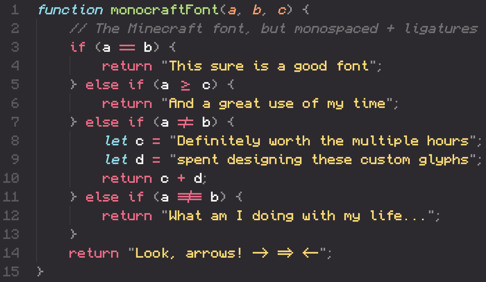
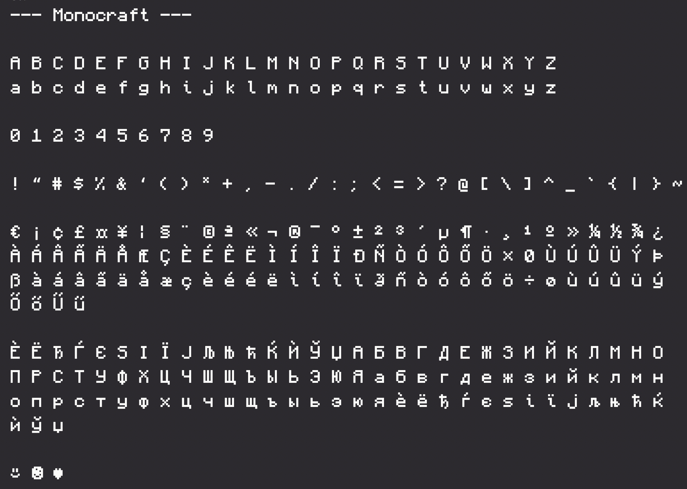
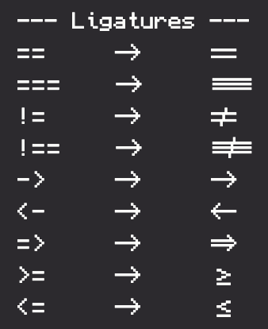
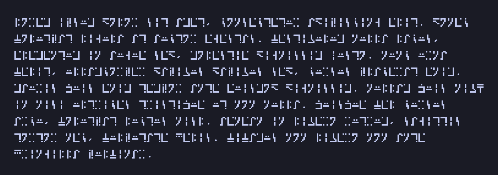

> **语言**：本文档为简体中文翻译，[点此查看英文原版 README.md](README.md)。

# Monocraft

[](https://GitHub.com/IdreesInc/Monocraft/releases/)

[](https://GitHub.com/IdreesInc/Monocraft/releases/)
<a href="https://discord.gg/6yxE9prcNc" target="_blank">
	
</a>

## [`点这里下载！`](https://github.com/IdreesInc/Monocraft/releases)
### [`获取更新与支持，欢迎加入我们的 Discord！`](https://discord.gg/6yxE9prcNc)
<br/>



一款为那些"有点 _太_ 喜欢 Minecraft"的开发者打造的等宽字体。

如果你想看看这款字体的矢量化版本，试试 [Miracode](https://github.com/IdreesInc/Miracode) 吧！

*注意：本项目与 Minecraft 或 Mojang 均无任何关联，纯粹是一个粉丝项目。本字体模仿了 Minecraft 界面中所用字体的字形，但并不包含原游戏中的任何素材或字体文件。*

## 特性

- Minecraft！
  - 本字体中的字符基于 Minecraft 界面所用的[字形](https://github.com/IdreesInc/Minecraft-Font)，并对每个字形做了更新以提升可读性与间距
- 等宽！
  - 本字体收录的 1500+ 个字形都经过精心重新设计，以适配等宽字体
  - 像 "i" 和 "l" 这样的细窄字符被重新加入了恰到好处的尾笔与衬线，使其在等宽环境中看起来更协调
- 编程连字（ligatures）！
  - 用全新的连字字符为你的编程生活增添一些滋味
  - 箭头看起来真的像箭头，比较运算符一眼就能看清
- 附魔台文字支持！
  - 输入 Minecraft 在附魔台文字中所用的"标准银河字母"（standard galactic alphabet）
  - 非常适合用"节肢杀手"来给你的代码"附魔"！

## 字形



## 如何安装

### Windows

从 [Releases](https://github.com/IdreesInc/Monocraft/releases) 页面下载最新的 `Monocraft.ttc` 文件。右键点击已下载的字体并选择 **Install**（安装）。根据你的机器情况，安装字体可能需要管理员权限。

### Mac

#### 使用 Homebrew

```shell
brew install --cask font-monocraft
```

#### 手动

从 [Releases](https://github.com/IdreesInc/Monocraft/releases) 页面下载最新的 `Monocraft.ttc` 文件。双击已下载的字体文件，并在弹出的窗口中选择 **Install Font**（安装字体）。更多帮助请见[这里](https://support.apple.com/en-us/HT201749)。

### Linux

从 [Releases](https://github.com/IdreesInc/Monocraft/releases) 页面下载最新的 `Monocraft.ttc` 文件。将该文件移动到 ~/.local/share/fonts（若该文件夹不存在则新建一个）。在终端中运行 `fc-cache -fv`。或者，注销后重新登录即可。

### 在你的网站上

要在你的网站上使用 Monocraft，请将以下代码添加到你的 CSS 中：

```css
@font-face {
    font-family: 'Monocraft';
    src: url('https://cdn.jsdelivr.net/gh/IdreesInc/Monocraft@main/dist/Monocraft-ttf/Monocraft.ttf') format('truetype');
    font-weight: normal;
    font-style: normal;
}
```

请注意，你需要将每个字重作为单独的 import 引入，因为大多数浏览器不支持打包的 `.ttc` 字体文件。

## 如何使用

按照上面的安装说明操作后，只需在任何支持自定义字体的应用程序中选择 "Monocraft" 字体（注意其中有空格）即可。你可能需要重启该应用程序或你的电脑，字体才会出现。

## 常见问题

### 有哪些可用的连字？

目前，本字体已加入以下连字：



在 [@Ciubix8513](https://github.com/Ciubix8513) 的贡献下，Monocraft 现在支持连续连字，让你能打出"根本停不下来"的箭头和线条。

如果你觉得还有哪个字符组合可以做成连字，欢迎创建一个 issue！

### 如何用附魔台文字书写？

Monocraft 在一个特殊的码点范围内支持了 Minecraft 用来表示附魔台文字的"标准银河字母"！想像个术士那样打字，请按以下步骤操作：

1. 按照上面的说明安装 Monocraft
2. 打开这个网站：https://cryptii.com/pipes/alphabetical-substitution
3. 将"ciphertext alphabet"替换为下面这个（别担心它看起来像一个个方框）：``
4. 在最左边的文本框中输入任何你想输入的内容，它会在右边的框中被转换成银河文字（不过暂时看起来还像方框）
5. 把输出的文字复制到装有 Monocraft 的编辑器里，见证奇迹吧！

这里有一些 Lorem Ipsum 占位文字，让你看看它的实际效果！



### 这些字符是如何生成的？

借助 [FontForge](https://fontforge.org/en-US/) 出色的 Python 扩展，字形是根据表示每个字符像素的配置文件生成的。变音符（diacritics）则单独创建，并与原始字符组合，生成 500 多个独一无二的字形。想了解更多信息，请查看 [src](https://github.com/IdreesInc/Monocraft/tree/main/src) 文件夹中的源代码。

### 有没有保留原始 Minecraft 字体（非等宽）的版本？

包在我身上，看看我复刻的 Minecraft 字形吧，就在[这里](https://github.com/IdreesInc/Minecraft-Font)。

### 如果我想用一款真正好用的字体怎么办？

完全能理解，可以看看 [Fira Code](https://github.com/tonsky/FiraCode)，它对细节的关注令人赞叹；或者看看 [Scientifica](https://github.com/nerdypepper/scientifica)，一款与本字体类似的位图字体。也欢迎看看我的另一款字体 [Miracode](https://github.com/IdreesInc/Miracode)，它基于 Monocraft，但要更实用一些！
